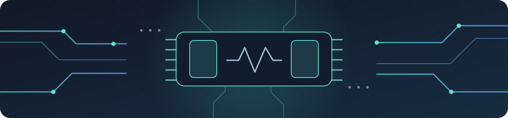

# FPGA



Мой рабочий репозиторий по цифровому дизайну. Сюда постепенно складываю лабораторные, куски RTL, отчёты и заметки о том, что сломалось и как починил. Пока всё только начинается — буду дополнять по ходу практики.

## Что уже есть

- Мануал школы лежит в [`Manuals/`](Manuals/synthesis_school_manual.pdf).
- На компьютере есть Git, Icarus Verilog 13, GTKWave, Java и Zed.
- Для примеров курса буду использовать стабильный репозиторий [basics-graphics-music](https://github.com/chipdesignschool/basics-graphics-music).


## План на старте

- [ ] На практике узнать модель платы и записать её в [заметки об окружении](docs/environment.md).
- [ ] Запустить первую RTL-симуляцию.
- [ ] Разобраться с временными диаграммами в GTKWave.
- [ ] После каждой работы добавлять короткий отчёт в [`reports/`](reports/README.md).

## Как запускаю пример

Исходники курса держу отдельным клоном, чтобы не смешивать их с моими заметками:

```bash
mkdir -p ~/src
git clone https://github.com/chipdesignschool/basics-graphics-music.git ~/src/basics-graphics-music
cd ~/src/basics-graphics-music
./check_setup_and_choose_fpga_board.bash
```

Потом перехожу в каталог нужной лабораторной, меняю `lab_top.sv` и запускаю симуляцию:

```bash
cd labs/<каталог-примера>
./02_simulate_rtl.bash
```

Синтез и прошивка нужны, когда есть подходящая плата и установленная для неё САПР:

```bash
./03_synthesize_for_fpga.bash
```

## Где что лежит

```text
Manuals/   мануал и материалы к нему
docs/      заметки о моём окружении и плате
labs/      мои решения и заметки по лабораторным
reports/   отчёты после практик
assets/    картинки для README
```

Для отчёта копирую [`reports/_template.md`](reports/_template.md). Обычно называю его по дате и теме, например `2026-10-10-counter.md`. Каталоги сборки и временные диаграммы в Git не добавляю — для них уже есть правила в [`.gitignore`](.gitignore).


## Ссылки

- [Мануал по установке ПО](Manuals/synthesis_school_manual.pdf)
- [BGM — стабильные примеры школы](https://github.com/chipdesignschool/basics-graphics-music)
- [SystemVerilog Homework](https://github.com/chipdesignschool/systemverilog-homework)
